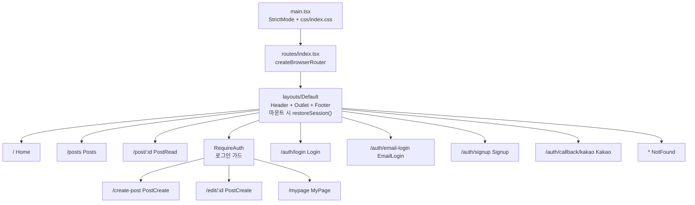
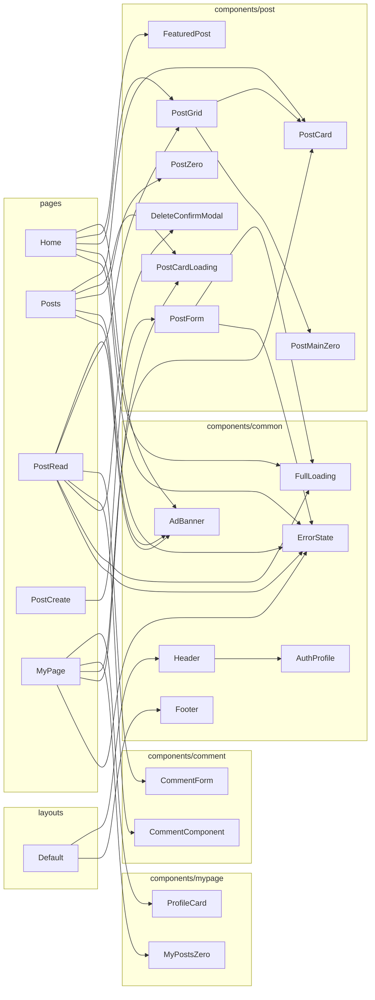
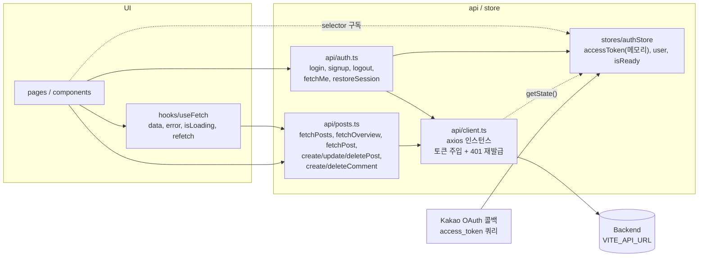
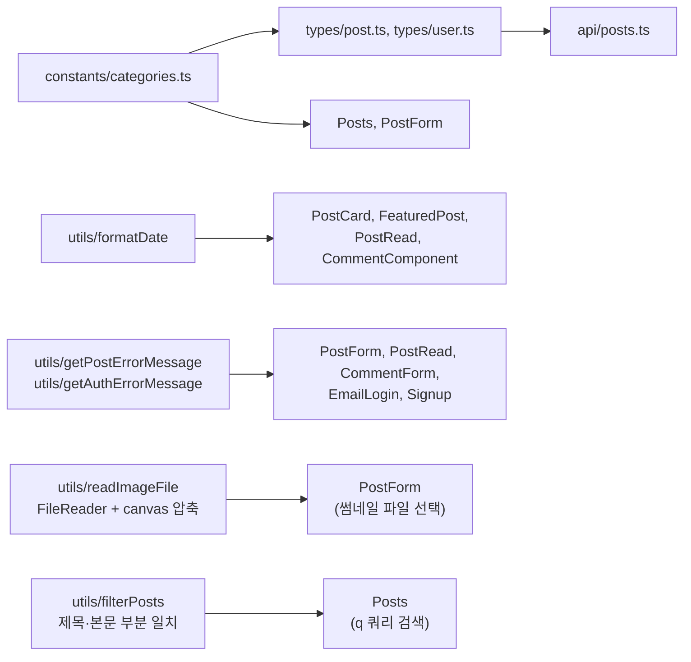
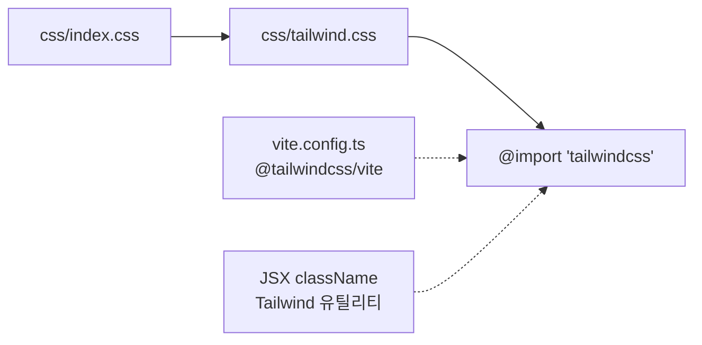

# 프론트엔드 아키텍처

블로그/게시글 서비스 SPA의 구조를 Mermaid 다이어그램으로 정리한 문서이다.
`src` 내부 import 관계를 기준으로 작성했으며, 구조가 바뀌면 함께 갱신한다.

## 1. 앱 진입과 라우팅

`main.tsx`가 `routes/index.tsx`의 라우터를 마운트하고, 모든 페이지는 `Default` 레이아웃 아래에 중첩된다.
작성/수정/마이페이지는 `RequireAuth` 가드 아래에 있어 로그인해야 접근할 수 있다.

- `PostCreate`는 `/create-post`(작성)와 `/edit/:id`(수정)가 공유하며, `key`로 경로가 바뀔 때 `PostForm` 상태를 초기화한다.
- `RequireAuth`는 `isReady`가 `false`면 `FullLoading`, 로그인하지 않았으면 `/auth/login`으로 `replace` 이동한다.

## 2. 레이아웃과 페이지의 컴포넌트 사용

화살표는 import 관계이다.

- 데이터는 **페이지가 조회**하고 컴포넌트에는 props로 내려준다 (`PostCard`는 `post`, `PostGrid`는 `title`/`posts`/`href`).
- `PostForm`과 `CommentForm`은 폼 상태를 직접 관리하되, 서버 호출은 `api/`를 통해서만 한다 (`CommentForm`은 부모가 넘긴 `onSubmit`을 호출).
- 검색: `Header`의 검색 폼이 `/posts?q=검색어`로 이동만 하고, `Posts`가 URL의 `q`를 읽어 처리한다 (`q`가 있으면 전체 조회 후 `filterPosts`로 거르고 클라이언트에서 페이지를 나눈다). `Header`의 입력값은 주소의 `q`가 바뀔 때 맞춘다.
- 마이페이지: `MyPage`가 `GET /posts`로 전체 글을 조회해 `filterMyPosts`로 내 글만 거르고, 정렬(`sort`)과 페이지(`page`)는 URL 쿼리로 관리한다. 글 수·총 조회수는 걸러낸 목록에서 계산해 `ProfileCard`에 props로 넘긴다.
- `Login`, `EmailLogin`, `Signup`, `Kakao`, `NotFound`는 공통 컴포넌트 없이 독립적인 마크업이다.

## 3. 데이터 흐름

모든 서버 요청은 `api/client.ts`의 axios 인스턴스를 거친다. 인증 상태는 zustand 스토어(`authStore`)가 가진다.

- `accessToken`은 메모리(store)에만 두고, refresh token은 httpOnly 쿠키(`withCredentials`)로 주고받는다.
- 응답이 401이면 `refreshAccessToken()`으로 재발급 후 원 요청을 1회 재시도한다. refresh는 진행 중인 Promise 하나를 공유한다 (refresh token이 매번 교체되기 때문).
- 앱 시작 시 `Default`가 `restoreSession()`을 호출해 refresh → `/auth/me` 순으로 로그인 상태를 복구하고, 끝나면 `isReady`를 `true`로 바꾼다.

### 타입과 유틸

## 4. 스타일링

